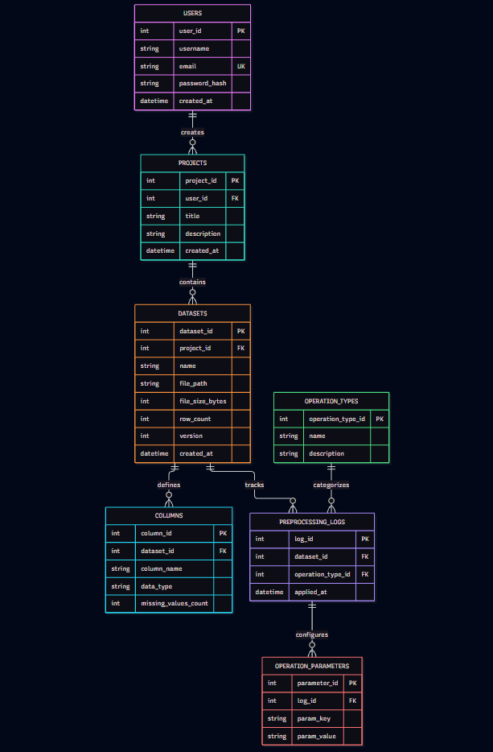

# Предпроектная аналитика сервиса работы с датасетами

## 1. Проблема проекта и что будет решать

Для подготовки данных к обучению моделей (ML) важно видеть распределение признаков, использование памяти датасетом и наличие пропущенных значений, также важно видеть состояние примененных шагов предобработки в одном интерфейс. Так как проверка каждого датасета вручную через локальные скрипты увеличивает затраченное время на проверку всех файлов и затрудняет поиск/анализ момента возникновения ошибок в данных.

В связи с этим мы хотим разработать сервис для просмотра текущих показателей датасетов и истории изменений через сайт (браузер). Предполагаемые пользователи - это исследователи данных (Data Scientists), учебные команды и аналитики небольших компаний. 

## 2. Что необходимо определить до разработки

До того как приступить к разработке нужно определить архитектурную структуру нашего проекта и распределение ответственности между ключевыми компонентами системы.

В приложении выделяется 3 основных слоя:
- Клиент (Фронтенд) — визуальный интерфейс в браузере пользователя для управления проектами и визуализации данных.
- Сервер (Бэкенд) — центральный узел бизнес-логики, отвечающий за авторизацию, валидацию и выполнение алгоритмов предобработки.
- База данных (БД) — надежное хранилище метаданных, схем датасетов и истории примененных пайплайнов.

## 3. Описание слоев архитектуры приложения

| Слой системы | Организация работы | Преимущества для проекта | Ограничения |
|---|---|---|---|
| Клиент (Фронтенд) | Отображает UI, собирает действия пользователя, отправляет HTTP-запросы и визуализирует графики в браузере | Не требует установки софта на ПК пользователя, обеспечивает интерактивное построение графиков и удобный UX | Зависит от производительности устройства пользователя при рендеринге больших таблиц или множества графиков |
| Сервер (Бэкенд) | Принимает файлы и запросы от клиента, выполняет ресурсоемкие расчеты статистик (EDA) и предобработку данных | Изолирует тяжелые вычисления от интерфейса, гарантирует безопасность данных и единую точку применения ML-пайплайнов | Требует контроля лимитов памяти при параллельной обработке файлов данных большого объема несколькими пользователями |
| База данных (БД) | Хранит структурированные метаданные, типы столбцов, настройки операций в 3НФ и учетные записи | Гарантирует целостность связей, позволяет быстро извлекать историю операций и метаданные без чтения сырых файлов | Не предназначена для хранения тяжелых бинарных файлов датасетов (их физические файлы хранятся отдельно на диске) |

**Предварительный выбор:** трехслойная клиент-серверная архитектура обеспечивает четкое разделение обязанностей, позволяя независимо разрабатывать интерфейс, масштабировать вычисления на бэкенде и поддерживать строгую структуру данных в БД.

### 3.1. Подходы уже существующих решений

| Решение | Что подтверждает документация | Значение для проекта |
|---|---|---|
| YData-Profiling | Генерирует расширенные интерактивные отчеты (EDA) по структуре DataFrame за одну строку кода | Подтверждает ценность автоматического вывода статистик и распределений в веб-формате. |
| DataProfiler (Capital One) | Библиотека автоматического анализа схем данных и выявления конфиденциальных признаков (PII) | Показывает важность разделения парсинга метаданных (схемы) и вычисления глобальных статистик. |
| Polars | Высокопроизводительный движок на Rust для молниеносной трансформации tabular-данных в многопоточном режиме | Обосновывает возможность эффективной очистки и кодирования датасетов на стороне бэкенда без зависания сервера. |

На что опирались:
документация YData-Profiling [📄 GitHub](https://github.com), обзор DataProfiler от Capital One [📄 GitHub](https://github.com), описание возможностей Polars [📄 Официальный сайт](https://pola.rs)

В существующих инструментах автоматический анализ и обработка данных выносятся в изолированные программные коннекторы. Этот пример показывает применение пакетного анализа данных (Data Profiling), который мы берем за основу бизнес-логики бэкенда.

## 4. Предлагаемые требования к первой версии

| Компонент | Предлагаемые функции | Обоснование |
|---|---|---|
| Интерфейс (Фронтенд) | Форма загрузки файлов, таблицы с метаданными столбцов, интерактивные графики распределений и конфигуратор очистки | Взаимодействие пользователя с системой через браузер |
| Сервер (Бэкенд) | Приём файлов от фронтенда, проверка прав сессии, идентификация проектов, расчет статистик и запуск пайплайнов предобработки | Централизованная обработка данных и бизнес-логика |
| Хранение (БД и диск) | Сохранение версий датасетов в файловое хранилище, запись метаданных и истории операций в реляционную БД | Анализ изменений и управление структурированными данными |
| Доступ | Регистрация, авторизация пользователя и проверка прав на чтение/модификацию конкретного проекта | Защита данных от несанкционированного доступа |
| Сбои передачи | Отображение ошибок валидации файла на фронтенде и возобновление задач после сбоев инфраструктуры | Корректное поведение при некорректных форматах данных или ошибках в коде очистки |

ERD Диаграмма проекта:

## 5. Вывод

Для разрабатываемого сервиса будет использоваться классическое клиент-серверное веб-приложение с выделенным слоем базы данных. Пользователь загружает файлы данных и настраивает конфигурацию очистки на Клиенте (в веб-интерфейсе). Сервер принимает эти запросы, выполняет вычисления, а также обращается к Базе данных для записи метаданных, структуры столбцов и логов пайплайна.

Разделение системы на Клиент, Сервер и БД позволяет избежать замусоривания интерфейсного кода тяжелой математикой обработки данных, обеспечивает централизованную валидацию и сохраняет историю версий датасетов в строгом соответствии с третьей нормальной формой.

# Источники

-  - Репозиторий экосистемы YData-Profiling (бывший pandas-profiling)
-  - Открытая библиотека DataProfiler от Capital One
-  - Документация высокопроизтивного движка обработки таблиц Polars
